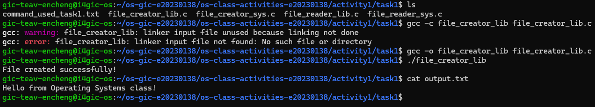
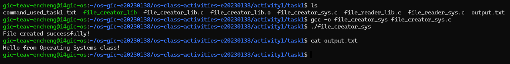
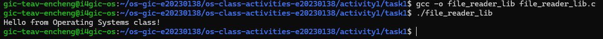
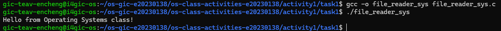
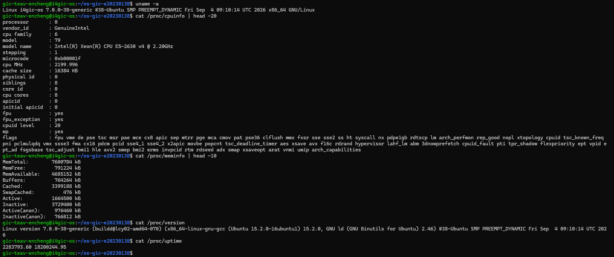
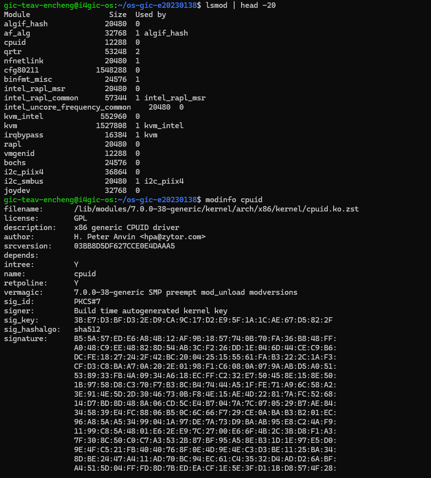
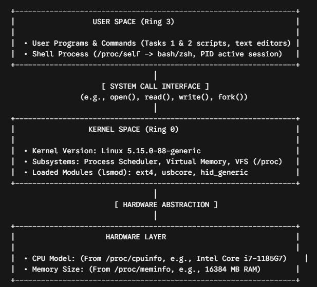

# Class Activity 1 — System Calls in Practice

- **Student Name:** TEAV ENCHENG
- **Student ID:** e20230138
- **Date:** [Date of Submission]

---

## Warm-Up: Hello System Call

Screenshot of running `hello_syscall.c` on Linux:

Screenshot of running `hello_winapi.c` on Windows (CMD/PowerShell/VS Code):

Screenshot of running `copyfilesyscall.c` on Linux:

---

## Task 1: File Creator & Reader

### Part A — File Creator

**Describe your implementation:** [What differences did you notice between the library version and the system call version?]

**Version A — Library Functions (`file_creator_lib.c`):**

<!-- Screenshot: gcc -o file_creator_lib file_creator_lib.c && ./file_creator_lib && cat output.txt -->

**Version B — POSIX System Calls (`file_creator_sys.c`):**

<!-- Screenshot: gcc -o file_creator_sys file_creator_sys.c && ./file_creator_sys && cat output.txt -->

**Questions:**

1. **What flags did you pass to `open()`? What does each flag mean?**

   > O_WRONLY: Opens the file for write-only access.
   > O_CREAT: Creates the file if it does not already exist.
   > O_TRUNC: Truncates the file length to zero if it already exists.

2. **What is `0644`? What does each digit represent?**

   > 0644 is an octal permission mask specifying file access permissions:
   > 0: Octal prefix format in C.
   > 6 (Owner): Read (4) + Write (2) permissions.
   > 4 (Group): Read-only permission.  
   > 4 (Others): Read-only permission.

3. **What does `fopen("output.txt", "w")` do internally that you had to do manually?**

   > fopen() automatically allocates an internal user-space memory buffer (via a FILE structure) and maps mode "w" to lower-level system call flags O_WRONLY | O_CREAT | O_TRUNC along with default permission modes (typically 0666 modified by system umask).

### Part B — File Reader & Display

**Describe your implementation:** [Your notes]

**Version A — Library Functions (`file_reader_lib.c`):**

**Version B — POSIX System Calls (`file_reader_sys.c`):**

**Questions:**

1. **What does `read()` return? How is this different from `fgets()`?**

   > read() returns the exact number of bytes read into the buffer as a ssize_t (returning 0 on EOF and -1 on error). fgets() returns a pointer to the character string buffer on success or NULL on EOF or error.

2. **Why do you need a loop when using `read()`? When does it stop?**

   > A loop is required because read() may fetch data in fixed byte chunks rather than the entire file at once. The loop terminates when read() returns 0, which signals End-Of-File (EOF).

---

## Task 2: Directory Listing & File Info

**Describe your implementation:** [Your notes]

### Version A — Library Functions (`dir_list_lib.c`)

### Version B — System Calls (`dir_list_sys.c`)

### Questions

1. **What struct does `readdir()` return? What fields does it contain?**

   > readdir() returns a pointer to a struct dirent. Key fields include d_name (null-terminated filename string), d_ino (inode number), d_type (file type), d_reclen (record length), and d_off (offset to the next dirent).

2. **What information does `stat()` provide beyond file size?**

   > Beyond file size (st_size), stat() provides permissions (st_mode), owner ID (st_uid), group ID (st_gid), inode number (st_ino), device ID (st_dev), link count (st_nlink), and access/modification timestamps (st_atime, st_mtime, st_ctime).

3. **Why can't you `write()` a number directly — why do you need `snprintf()` first?**

   > write() writes raw byte memory. Passing an integer directly writes raw binary bits (e.g., 0x0000002A), outputting unprintable control codes rather than ASCII numerals. snprintf() formats integer values into human-readable ASCII text characters prior to calling write().

---

## Optional Bonus: Windows API (`file_creator_win.c`)

Screenshot of running on Windows:

### Bonus Questions

1. **Why does Windows use `HANDLE` instead of integer file descriptors?**

   > [Your answer]

2. **What is the Windows equivalent of POSIX `fork()`? Why is it different?**

   > [Your answer]

3. **Can you use POSIX calls on Windows?**

   > [Your answer]

---

## Task 3: strace Analysis

**Describe what you observed:** [What surprised you about the strace output? How many more system calls did the library version make?]

### strace Output — Library Version (File Creator)

<!-- Screenshot: strace -e trace=openat,read,write,close ./file_creator_lib -->
<!-- IMPORTANT: Highlight/annotate the key system calls in your screenshot -->

### strace Output — System Call Version (File Creator)

<!-- Screenshot: strace -e trace=openat,read,write,close ./file_creator_sys -->
<!-- IMPORTANT: Highlight/annotate the key system calls in your screenshot -->

### strace Output — Library Version (File Reader or Dir Listing)

### strace Output — System Call Version (File Reader or Dir Listing)

### strace -c Summary Comparison

<!-- Screenshot of `strace -c` output for both versions -->

### Questions

1. **How many system calls does the library version make compared to the system call version?**

   > There are 6 The library version makes additional system calls during execution due to dynamic loader setup, dynamic heap allocation, and stdio buffer handling compared to the direct system call binary.

2. **What extra system calls appear in the library version? What do they do?**

   > brk / mmap: Allocate dynamic heap space and memory-map standard stream buffer segments.
   > fstat / newfstatat: Query file descriptor status to determine buffer chunk sizing.
   > openat: Locate and map shared C library dependencies (libc.so).

3. **How many `write()` calls does `fprintf()` actually produce?**

   > fprintf() buffers output in user space and typically produces a single combined write() system call when the internal memory stream is explicitly flushed or closed.

4. **In your own words, what is the real difference between a library function and a system call?**

   > A library function executes entirely in user space to provide memory management, algorithms, and stream buffers. A system call executes CPU trap/interrupt instructions to cross into privileged kernel space to request kernel routines perform hardware operations.

---

## Task 4: Exploring OS Structure

### System Information

> 📸 Screenshot of `uname -a`, `/proc/cpuinfo`, `/proc/meminfo`, `/proc/version`, `/proc/uptime`:

### Process Information

> 📸 Screenshot of `/proc/self/status`, `/proc/self/maps`, `ps aux`:

### Kernel Modules

> 📸 Screenshot of `lsmod` and `modinfo`:

### OS Layers Diagram

> 📸 Your diagram of the OS layers, labeled with real data from your system:

### Questions

1. **What is `/proc`? Is it a real filesystem on disk?**

   > /proc is a virtual (pseudo) filesystem generated dynamically by the Linux kernel. It does not exist on disk; it acts as a kernel interface exposing real-time process data structures directly from memory.

2. **Monolithic kernel vs. microkernel — which type does Linux use?**

   > Linux uses a monolithic kernel architecture, running all primary operating system capabilities (file systems, networking, device drivers, memory management) within a single privileged kernel space (modularized dynamically with Loadable Kernel Modules).

3. **What memory regions do you see in `/proc/self/maps`?**

   > Standard regions include .text (code instructions), .data / .bss (global variables), [heap] (dynamically allocated memory), shared library mappings (.so), [stack] (local variables and call stack), and kernel dynamic mapping vectors ([vdso] / [vvar]).

4. **Break down the kernel version string from `uname -a`.**

   > Linux: i4gic-os
   > 7: Major version.
   > 0 : Minor version.
   > 0-38 : Patch/build number.
   > generic: Target build architecture profile.
   > SMP / PREEMPT: Multi-core symmetric processing and CPU scheduling model.

5. **How does `/proc` show that the OS is an intermediary between programs and hardware?**
   > /proc exposes hardware telemetry (CPU stats in /proc/cpuinfo, memory state in /proc/meminfo) via standard file interfaces, enabling user-space programs to query hardware data safely through operating system abstractions without direct access to hardware registers.

---

## Reflection

What did you learn from this activity? What was the most surprising difference between library functions and system calls?

> [Write your reflection here]
