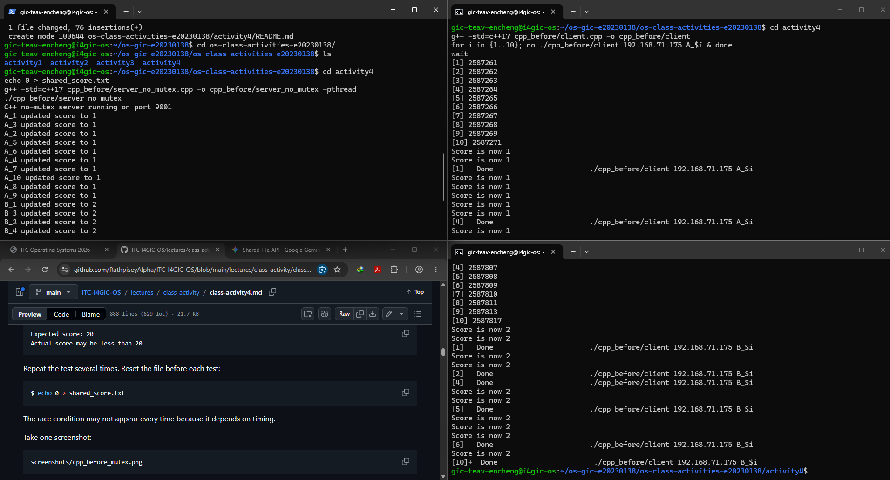
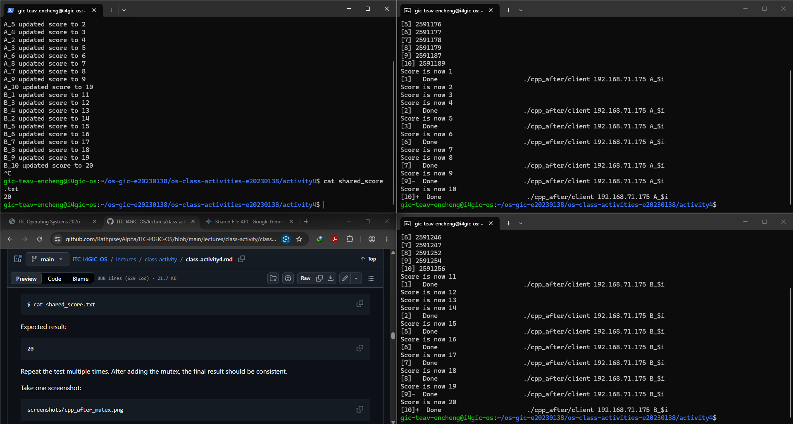

# Class Activity 4 — Shared File API

- **Student Name:** TEAV ENCHENG
- **Student ID:** e20230138
- **Partner Name:** Partner Name Here
- **Partner Student ID:** Partner ID Here
- **Server Machine Owner:** [Your Name / Partner Name]
- **Server IP Address:** 192.168.X.X

---

## Task 1: C++ Before Mutex

- Expected score after 20 total client requests: 20
- Actual score: 14 (varies due to timing)
- What happened: Multiple server threads read and wrote to `shared_score.txt` concurrently without mutual exclusion, causing race conditions and lost updates.

---

## Task 2: C++ After Mutex

- Expected score after 20 total client requests: 20
- Actual score: 20
- What changed after adding mutex: `std::lock_guard<std::mutex>` ensured mutual exclusion, forcing threads to wait their turn during the critical section.

---

## Task 3: Java Before Synchronized

- Expected score after 20 total client requests: 20
- Actual score: 12 (varies due to timing)
- What happened: Unsynchronized concurrent threads interleaved their read-and-write operations on the shared file.

---

## Task 4: Java After Synchronized

- Expected score after 20 total client requests: 20
- Actual score: 20
- What changed after adding synchronized: The `synchronized` keyword on `updateScore` protected the critical section, serializing all thread executions.

---

## Questions

1. **Why should clients send requests to the server instead of writing the file directly?**
   Centralized control eliminates unreliable network file locking and prevents severe security and corruption risks.

2. **Why does the server still have a race condition before mutex or synchronized?**
   Spawning multiple worker threads without locking allows simultaneous execution of the critical section.

3. **In the C++ fixed version, what does `std::lock_guard<std::mutex>` protect?**
   It protects the file-updating critical section inside `update_score`.

4. **In the Java fixed version, what does `synchronized` protect?**
   It secures the `updateScore` method via monitor locking to prevent concurrent access.

5. **Why is the final score expected to be 20 when Student A sends 10 requests and Student B sends 10 requests?**
   20 total requests each add 1 to the initial score of 0.

6. **What could happen if two separate servers update the same file at the same time?**
   Process-level race conditions would occur because intra-process locks do not synchronize across separate operating system processes.

---

## Reflection

Comparing C++ (`std::mutex` / `std::lock_guard`) and Java (`synchronized`) reveals that both languages rely on mutual exclusion locks to protect critical sections in multi-threaded network servers. This activity demonstrated firsthand how concurrency control prevents data corruption and ensures atomic updates to shared resources.